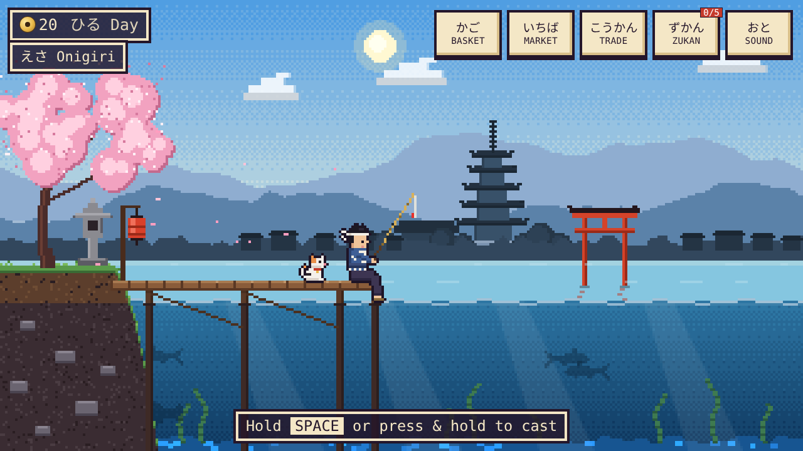
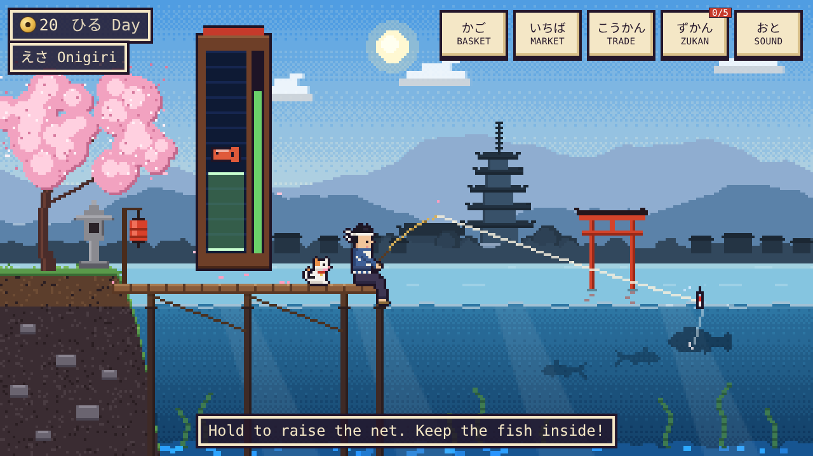
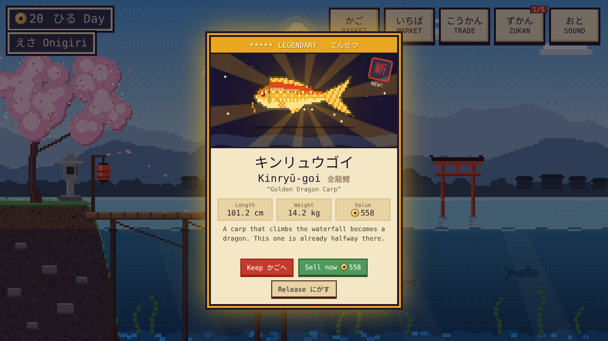
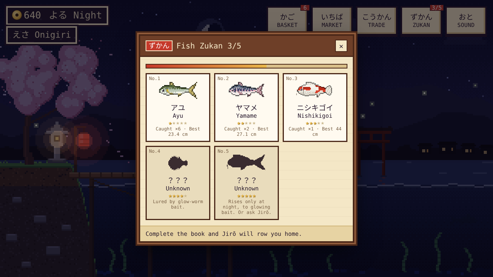
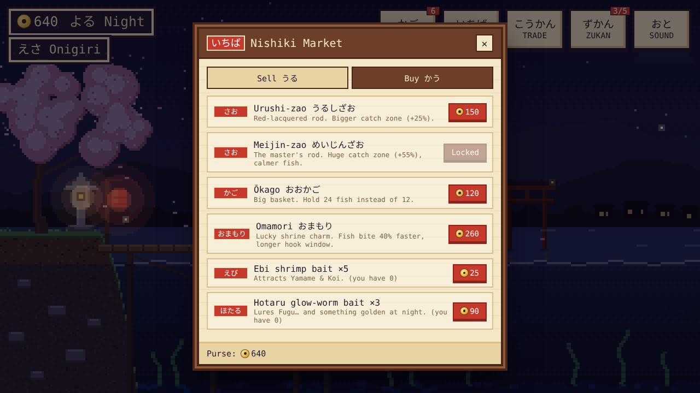
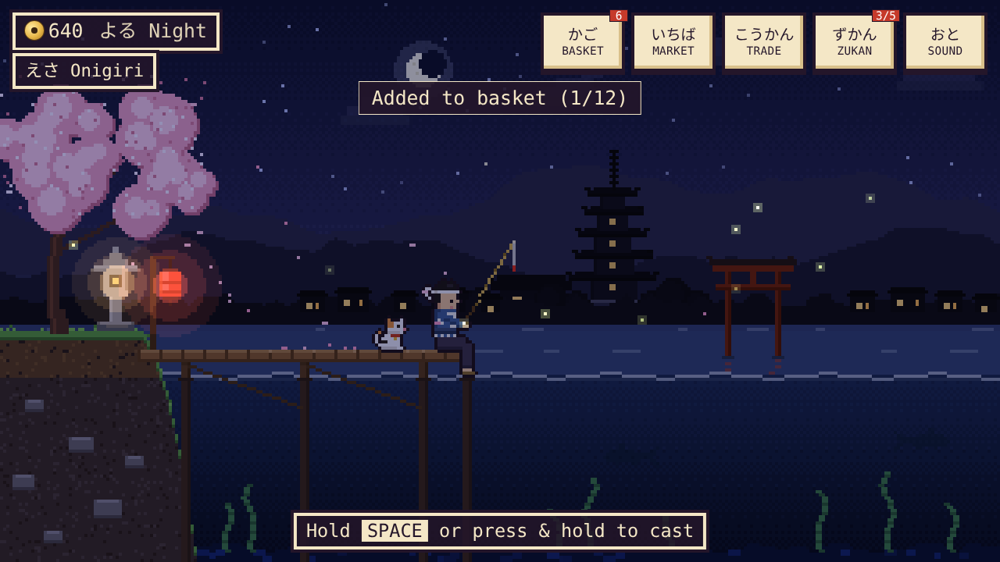

# Lost in Kyoto: A Fishing Tale

[](https://github.com/mtutajewski/Lost-in-Kyoto/actions/workflows/ci.yml)

**JavaScript (Canvas 2D, Web Audio API) · HTML/CSS · Python (pytest, Playwright) · GitHub Actions**

A 2D pixel-art fishing game set on a Kyoto riverbank, playable in any browser.

- **The game:** cast, wait for a bite, win a reeling minigame, inspect your catch, then sell it, trade it or release it. Catch all **5 fish** to complete the *Zukan* (fish book) and find your way home.
- **The engineering:** every graphic is generated in code, so there are **no image files**. Every sound is synthesized. The whole game is **~83 KB** with no frameworks, and an automated test suite plays it in a headless browser on every push.



---

## The story

You missed the last train. Your phone is dead. On a quiet riverbank under a cherry tree, an old bamboo rod leans against a stone lantern and a calico cat watches you expectantly. Jirō-san, the old ferryman, makes you an offer: *fill the river's fish book, and at dawn he will row you home.*

## How to play

| Step | Controls | What happens |
| --- | --- | --- |
| **Cast** | hold `Space` / press & hold, then release | a power bar charges; a farther cast attracts rarer fish |
| **Wait** | watch the float | small nibbles, then the float dives and a **!** appears |
| **Hook** | press quickly | press too early and you reel in; too late and the fish steals the bait |
| **Reel** | hold to raise the green net | keep the fish inside the net until the progress bar fills |
| **Inspect** | Keep / Sell now / Release | releasing a fish brings luck on your next casts |

Shortcuts: `B` basket · `M` market · `T` trade · `Z` zukan · `E` change bait · `Esc` close.



## What's inside

- **5 fish, 5 rarity tiers:** Ayu (アユ), Yamame (ヤマメ), Nishikigoi (ニシキゴイ), Fugu (フグ) and the legendary Kinryū-goi (キンリュウゴイ), the Golden Dragon Carp. Each catch has its own random length, weight and value, and the Zukan records your personal best.
- **Catch inspection card:** the fish leaps out of the water and lands on a card with rarity rays, stats and a red *hanko* stamp the first time you catch a species.
- **Economy:** sell at **Nishiki Market**, then buy better rods (Takezao → Urushi-zao → Meijin-zao), a bigger basket, an Omamori charm and bait (Ebi shrimp, Hotaru glow-worm).
- **Trading:** Jirō-san swaps fish for rarer ones, for example 3 Ayu → 1 Yamame. The legendary carp can also be traded for one of each other fish.
- **A living world:** a full day cycle (あさ → ひる → ゆうがた → よる) changes the light, the music and which fish bite. The scene has cherry petals, fireflies, a glowing stone lantern and lit temple windows. The legendary carp only rises at night.
- **Ending:** completing the Zukan triggers *hanabi* fireworks, which then return every night.
- **Saving:** progress is saved automatically in the browser.

| Catch card | Fish book (Zukan) | Market |
| --- | --- | --- |
|  |  |  |



## Design decisions

- **Art generated in code, not drawn in files.** Each fish is described by a few parameters (body profile, tail shape, fins, colours, pattern) and rendered pixel by pixel with shading, a one-pixel outline and a highlight. The scene uses ordered (Bayer) dithering for skies and water, as 16-bit games did. Result: one consistent pixel-art style and a tiny download.
- **Sound synthesized live.** The music is a randomized koto-style melody in the Japanese *In* scale (*miyako-bushi*). Splashes, bites and coins are built from oscillators and filtered noise, so no audio files are needed.
- **A low-resolution canvas, scaled up.** The game renders at 320×180 and scales with nearest-neighbour sampling, so pixels stay crisp on any screen. The HUD and panels are HTML scaled to the same grid, so text stays sharp and works with mouse, keyboard and touch.
- **Difficulty tuned with a simulated player.** The reeling minigame was balanced by running a bot that reacts 0.35–0.75 s late and holds imprecisely. Common fish are near-certain with the starter rod, while the legendary fish rewards upgrading. The tests keep these targets from regressing.
- **Consistently Japanese.** The page is marked as Japanese (`lang="ja"`), so kanji render with Japanese rather than Chinese glyph shapes. Labels use hiragana, and fish names use katakana as Japanese field guides do. Clothing, coins (the 5-yen coin) and architecture (a five-storey pagoda modelled on Tō-ji, a torii, a stone *tōrō* lantern) are Japanese too.
- **Plain scripts, no build step needed.** The code is split into ordinary scripts, so `index.html` opens straight from disk with a double-click. `run.py build` additionally produces a single self-contained HTML file for sharing.

## Testing

**18 automated tests** run in headless Chromium with pytest and Playwright, on every push via GitHub Actions:

| Area | What is checked |
| --- | --- |
| Loading | the game and the single-file build start with **0 JavaScript errors** |
| Art | all 5 fish sprites are generated and actually drawn |
| Core loop | cast → bite → reel → catch card → basket; escapes; pressing too early |
| Economy | selling, buying, not buying without coins, basket capacity, trading with Jirō-san |
| Progress | the save survives a page reload; completing the Zukan triggers the ending |
| Difficulty | a simulated late-reacting player catches common fish ≥95% of the time with the starter rod and the legendary fish ≥90% with the best rod; better rods never make the game harder |

## Skills demonstrated

| Area | Techniques |
| --- | --- |
| JavaScript | Canvas 2D rendering, game loop with delta time, state machine, particle systems, procedural pixel-art generation, value noise, ordered dithering |
| Audio | Web Audio API synthesis, scheduling a generative melody, feedback delay, filtered noise |
| Front end | responsive scaling, HTML/CSS UI over a canvas, pointer + keyboard + touch input, `localStorage` saving |
| Game design | economy and progression, rarity-weighted spawning, difficulty balancing with a simulated player |
| Testing & tooling | pytest, Playwright browser automation, GitHub Actions CI, a Python build script that inlines assets |

## How to run

**Just play:** open `index.html` in a browser. Nothing to install.

For the tools (tests, build, screenshots):

```bash
python3 -m venv .venv && source .venv/bin/activate
pip install -r requirements.txt
python -m playwright install chromium

python run.py play          # serves the game locally and opens it in your browser
python run.py build         # creates dist/lost-in-kyoto.html, one self-contained file to share
python run.py test          # runs the automated browser tests
python run.py screenshots   # regenerates the screenshots in images/
python run.py check         # what CI runs: build, then test
```

## Structure

```
index.html    the game page (open it directly in a browser)
css/          styles for the HUD, panels, catch card and title screen
js/           game code, loaded in order:
                core     canvas setup, colour and pixel-drawing helpers
                data     fish, rarities, rods, bait, trades, save state
                sprites  fish, fisherman and cat pixel-art generators
                world    day cycle, background and foreground scenery
                audio    synthesized music and sound effects
                game     state machine, reeling minigame, per-frame update
                render   drawing the scene each frame
                ui       HUD, catch card, Basket / Market / Trade / Zukan panels
                main     input, layout and the main loop
tests/        automated browser tests (pytest + Playwright)
tools/        screenshot generator for this README
images/       screenshots used in this README
run.py        single entry point for all workflows
.github/      CI workflow
```

---

**Marcin Tutajewski** · [GitHub](https://github.com/mtutajewski) · MIT licence
